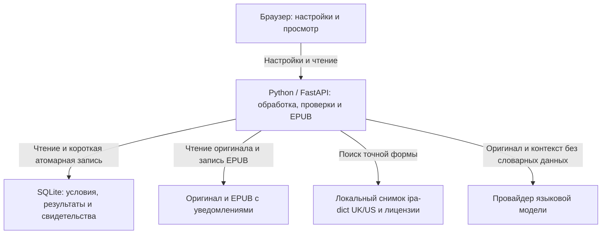

# ADR: Проверяемые подсказки произношения для точных вхождений

> **Статус:** Accepted

- Дата: 2026-10-29; пересмотр источника: 2026-10-31.
- Тема: выборочные IPA для британского или американского английского в просмотре и EPUB.
- BRIEF: [Выборочная транскрипция слов с неочевидным произношением](BRIEF-pronunciation-hints-2026-10-25.md).
- UX: описание поведения в BRIEF; отдельные макеты не заданы.
- Основание: [первоначальное исследование](reports/ADR-research-2026-10-29.md), текущая реализация и подтверждённый пользователем выбор `ipa-dict` с пропуском неоднозначных вариантов.

## 0. Коротко

**Зачем.** Понятное по смыслу слово может оказаться трудным для произнесения. Читатель получает компактную опору рядом с нужным употреблением, сохраняя оригинал.

**Решение.** Основной источник — локальный снимок [ipa-dict](https://github.com/open-dict-data/ipa-dict), отдельно UK и US. Модель находит трудное слово и описывает контекст; IPA берётся из набора. Для точной формы принимается только одна различимая IPA выбранного варианта, остальные случаи пропускаются.

**Предел проверки.** Набор связывает написание с IPA, но не содержит значений, частей речи или грамматических меток. Единственная IPA в снимке подтверждает запись набора, а не полноту всех чтений слова и не соответствие его значению. Свидетельство явно отмечает этот предел; независимая языковая проверка остаётся условием выпуска.

**Что получает читатель.** До обработки он включает помощь и выбирает UK/US; подсказки доступны со значением или самостоятельно в просмотре и EPUB. Повторы ведут к уже сохранённой подсказке. Если `read` отсутствует или имеет несколько IPA, оба контекста `I read…` и `Yesterday I read…` остаются без IPA: выбор между ними этим набором не обещается.

**Цена.** Покрытие ограничено, данные могут содержать ошибки, обязательны версии и лицензионные уведомления. Открытые лицензии заменяют переговоры с поставщиком, но не отменяют проверку их соблюдения при поставке приложения и EPUB.

## 1. Контекст

Произношение зависит от значения, формы и варианта английского. BRIEF требует точного вхождения, самостоятельной помощи в `READ_AS_IS`, проверяемого основания и завершения книги при отсутствии подтверждения. Уровень берётся из существующих условий книги; его отсутствие не требует новой настройки.

Проект остаётся локальным приложением на FastAPI, SQLAlchemy/SQLite и EbookLib; отдельный словарный сервис, новая очередь и новые роли не вводятся. Пользователь 2026-10-31 выбрал `ipa-dict` и подтвердил ограниченную первую версию: однозначная запись показывается, неоднозначная пропускается. Положительная контекстная развилка омографов из исходного BRIEF остаётся вне покрытия этого источника и не объявляется проверенной.

## 2. Текущее состояние

- Условия книги уже сохраняют включение, UK/US, версии модельного канала и неизменяемую ревизию; старые снимки не расширяются задним числом.
- Модельный контракт предлагает точный якорь, фактическую форму и контекстные признаки, запрещая IPA, словарные записи и адреса источников.
- [Порт источника](../../../src/linguary/application/ports/pronunciation.py) и [свидетельство](../../../src/linguary/domain/pronunciation.py) сейчас требуют семантические поля; [проверка](../../../src/linguary/application/validators/pronunciation.py) сравнивает их с предположениями модели. Для `ipa-dict` эти поля недоступны, поэтому нужен отдельный тип основания.
- [Адаптер по умолчанию](../../../src/linguary/adapters/pronunciation/source.py) отключён; существующие проверки источника используют искусственные данные.
- Сохранение, архивирование, общая проекция, ссылки повторов, просмотр и EPUB уже реализованы. Новые данные должны пройти через этот же жизненный цикл, без переписывания принятых материалов старых книг.

## 3. Решение

### Источник и права

Подключаем только локальные `data/en_UK.txt` и `data/en_US.txt` из закреплённой ревизии `ipa-dict`. Снимок включает исходные файлы, контрольные суммы, происхождение, версию способа разбора и лицензионные тексты. Обновление набора выполняется явно; при обработке и чтении сетевых запросов к словарю нет. Интерфейс источника остаётся заменяемым.

[README ipa-dict](https://github.com/open-dict-data/ipa-dict#credits) указывает en_US на основе `cmudict-ipa` и `syllabify` с MIT, en_UK — на основе `ipacards` с GPL-3.0; общий MIT не отменяет лицензии исходных наборов. Сохраняем уведомления `ipa-dict`, применимых исходных проектов и их авторов, полные тексты лицензий, ссылки на закреплённые исходники и отметки наших преобразований. Для поставляемой копии UK-данных и производных словарных материалов выполняются условия GPL-3.0, включая доступность соответствующих исходных данных; точная схема поставки и EPUB проверяется в Q-1.

[Описание ipacards](https://github.com/melissaboiko/ipacards/blob/master/deck_description.md) относится к экспериментальной учебной колоде примерно на 1000 слов и прямо предупреждает: IPA автоматически получена через eSpeak, возможны ошибки и оставшиеся омографы. Импортируемый файл `ipa-dict` шире этой колоды; размер колоды не считается размером словаря, а GPL не считается подтверждением языкового качества.

### Отбор и принятие

Модель предлагает точное слово, причину риска чтения и описание контекста из оригинала; IPA, фонетическое ударение и окончания она не создаёт. Канал работает в `TRANSLATE`, `GLOSSARY_ONLY` и `READ_AS_IS` независимо от перевода и смысловой помощи; длина и редкость сами по себе не дают кандидата.

До поиска проверяются принадлежность книге и группе, дословный якорь и целая словоформа. Адаптер собирает все варианты IPA для ключа в выбранном UK/US наборе, включая альтернативы внутри одной строки; первая запись не выбирается автоматически. После безопасного разбора и устранения точных дублей допустима ровно одна IPA. Несколько IPA, отсутствие формы, некорректная запись и неподтверждённое имя дают пропуск с причиной. Имена не получают подтверждение только из присутствия написания в наборе.

Для `ipa-dict` используются только непосредственно сохранённые формы. Окончания не дописываются по предположению модели и не выводятся из основы без отдельного проверяемого правила. Уже существующие виды оснований с подтверждёнными значением, частью речи и правилами производных форм сохраняют прежние строгие требования.

Добавляется явный вид свидетельства «точная форма в лексиконе». Он хранит выбранную IPA, UK/US, исходный ключ, идентификатор записи, снимок источника, атрибуцию и лицензию, а семантические поля обозначает отсутствующими. Значение и часть речи из модели нельзя копировать в словарное свидетельство или заменять фиктивными строками. Для прежнего семантического вида свидетельства обязательность этих полей не ослабляется; старые данные читаются совместимо.

Контекстные признаки модели остаются основанием отбора, а не доказательством чтения. Одна IPA в файле может быть неполной записью омографа; такие ошибки и уместность отбора проверяются независимой вычиткой Q-2. До неё результат нельзя объявлять доказанной контекстной точностью.

### Хранение, версии и сбои

Сохраняем типизированную помощь с точным якорем и свидетельством, связанную с книгой, ревизией условий и принятой попыткой. Поиск и уникальность привязок остаются в SQLite; принятые новые данные публикуются атомарно короткой транзакцией с проверкой актуальности. Удаление книги удаляет её помощь и свидетельства, не затрагивая общий снимок набора.

Повторная обработка тех же условий идемпотентна. Технический отказ источника отличим от проверенного отсутствия: временный отказ сохраняет прежнюю принятую помощь для затронутых якорей, проверенный новый результат может заменить её. Переводы и смысловые материалы не теряются из-за произношения. Исходный документ неизменяем; другой файл загружается как новая книга.

Смена UK/US, политики, способа разбора или версии источника требует новой ревизии условий; старые артефакты и архивы сохраняют собственные основания. Локальный снимок и принятые результаты — устойчивые данные. Необязательный кэш разделяется по источнику, версии, форме и UK/US; контекстное решение дополнительно связано с ревизией и точным вхождением. Ошибка чтения файла не кэшируется как отсутствие слова.

### Просмотр, EPUB и безопасность

Веб и EPUB читают один принятый артефакт без нового словарного или модельного запроса. В пределах ревизии одинаковые фактическая форма, IPA и UK/US имеют одну компактную запись; порядок оригинала определяет первое появление независимо от завершения задач. Первое вхождение показывает помощь под абзацем, остальные ведут к ней; при наличии значения показ объединяется, иначе остаётся самостоятельным. EPUB сохраняет сноску и обратные ссылки.

Источник, версия и атрибуция доступны рядом с помощью; полные уведомления и лицензии доступны в приложении и включаются в EPUB с используемыми словарными материалами по схеме Q-1. Сохранённая информация о лицензии остаётся доступной без сети. Правовой режим целого оригинального произведения не выводится автоматически из лицензии добавленной таблицы произношений.

Оригинал сохраняется дословно. IPA передаётся текстом Unicode, краткая памятка объясняет ударение и обозначения; совместимость программ чтения подтверждается по Q-3. Данные источника, ссылки и атрибуция обрабатываются как недоверенный текст: разметка экранируется, адреса проверяются. Текст книги и полные абзацы поставщику не отправляются; словарные данные не передаются модели, адреса из книги и ответа модели не используются для запросов.

Границы ответственности прежние: условия владеют ревизией; прикладной слой — отбором и принятием; адаптер — локальным получением и разбором данных; домен — допустимым свидетельством и точным якорем; представления — компоновкой и переходами. Авторизация проверяет книгу, вхождение и результат в одном рабочем контексте.

## 4. Рассмотренные альтернативы

| Вариант | Плюсы | Ограничения и решение |
| --- | --- | --- |
| Локальный `ipa-dict`, отдельная помощь — выбран | Открытые данные, воспроизводимый снимок, автономное чтение и EPUB | Нет семантических меток, ограниченная точность и покрытие; только одна IPA точной формы, прочее пропускается. |
| Более полный источник со значениями и частями речи — отложен | Позволяет подтверждать контекстные омографы и правила форм | Нужны подходящие данные и права; адаптер заменяем, текущий источник не выдаётся за такой словарь. |
| Расширить `FragmentAssistance` или `LanguageNote` — отвергнут | Переиспользует часть показа и навигации | Смысловая помощь имеет иные проверки и жизненный цикл, `LanguageNote` не привязана к точному вхождению. |
| Получать IPA от модели — отвергнут | Не нужен внешний набор и шире покрытие | Модель может предложить правдоподобную неверную IPA; её ответ не является независимым свидетельством. |
| Запрашивать обычный API при каждом чтении — отвергнут | Не нужно поставлять локальный набор | Чтение зависит от сети; обычный доступ к API не подтверждает права на постоянное хранение и EPUB. |

## 5. Обоснование

Точный якорь и отдельное свидетельство позволяют дать произношение без навязанного перевода. Общая запись и ссылки убирают дубли; снимки условий, архив и короткая транзакция сохраняют прежние границы повторной обработки. Локальный открытый набор выбран ради доступности, воспроизводимости, приватности текста и автономного EPUB. Ограниченное покрытие принимается через пропуск неподтверждённого, а не через догадку модели.

## 6. Риски

- Уведомлений корневого MIT недостаточно для UK GPL-3.0 и исходных компонентов; Q-1 проверяет реальную поставку, источники и EPUB. Открытая лицензия не объявляется разрешением без условий.
- UK-данные могут содержать ошибки автоматической генерации, а единственная IPA не доказывает полноту чтений. Q-2 включает независимую проверку самих записей и контекстов; омографы без доказательства пропускаются.
- Частичные и параллельные повторы способны потерять помощь или породить дубли; привязка к актуальной попытке, атомарная запись и общий порядок оригинала сохраняются.
- Программы чтения по-разному показывают IPA, ударения и переходы; Q-3 подтверждает согласованную матрицу до заявления о совместимости.

## 7. C4: Context

Читатель задаёт условия в Linguary, языковая модель предлагает слова и контекст, локальный `ipa-dict` даёт исходные IPA. Программа чтения получает автономный EPUB с принятыми подсказками и уведомлениями. Сетевого словарного поставщика в выбранном варианте нет.

## 8. C4: Container & Data Flow

Прикладной слой получает кандидатов, локально проверяет якорь и результат источника, затем атомарно сохраняет актуальную помощь. Веб и EPUB читают общую проекцию сохранённого снимка; ни сеть, ни модель для повторного чтения не нужны.

## 9. Допущения, открытые вопросы и история

- Q-1, условие выпуска: выбран `ipa-dict`, но комплект лицензий, уведомлений, соответствующих исходных данных и схема распространения UK-материалов в приложении/EPUB должны пройти проверку. Решает владелец продукта по подготовленному комплекту; по умолчанию локальное подключение реализуется, соответствие поставки правам не объявляется подтверждённым до проверки, выпуска нет. Письмо коммерческому словарю не требуется.
- Q-2, условие выпуска по AC8: контрольный набор и пороги точности/уместности согласуют владелец продукта и независимый языковой редактор. Набор включает положительные и отрицательные примеры, точные формы, UK/US, имена, отсутствующие и неоднозначные записи; наличие одной IPA не заменяет вычитку. По умолчанию точность не заявляется и выпуск не подтверждается до порога и проверки.
- Q-3, условие выпуска по AC7/AC8: программы чтения и начертания IPA согласует владелец продукта. По умолчанию сохраняются Unicode, памятка и двусторонние ссылки; совместимость подтверждается на явно согласованной матрице.
- Допущение: локальная модель использования и текущие ограничения доступа достаточны; многопользовательский словарный сервис и новые роли вне задачи.
- История: первоначальное решение принято пользователем 2026-10-29; 2026-10-31 пользователь выбрал `ipa-dict`, подтвердил пропуск неоднозначных записей и поручил подключение. Остальные решения и выполненные фазы P1–P7 сохраняются; новые работы оформляются отдельными фазами SDD.
