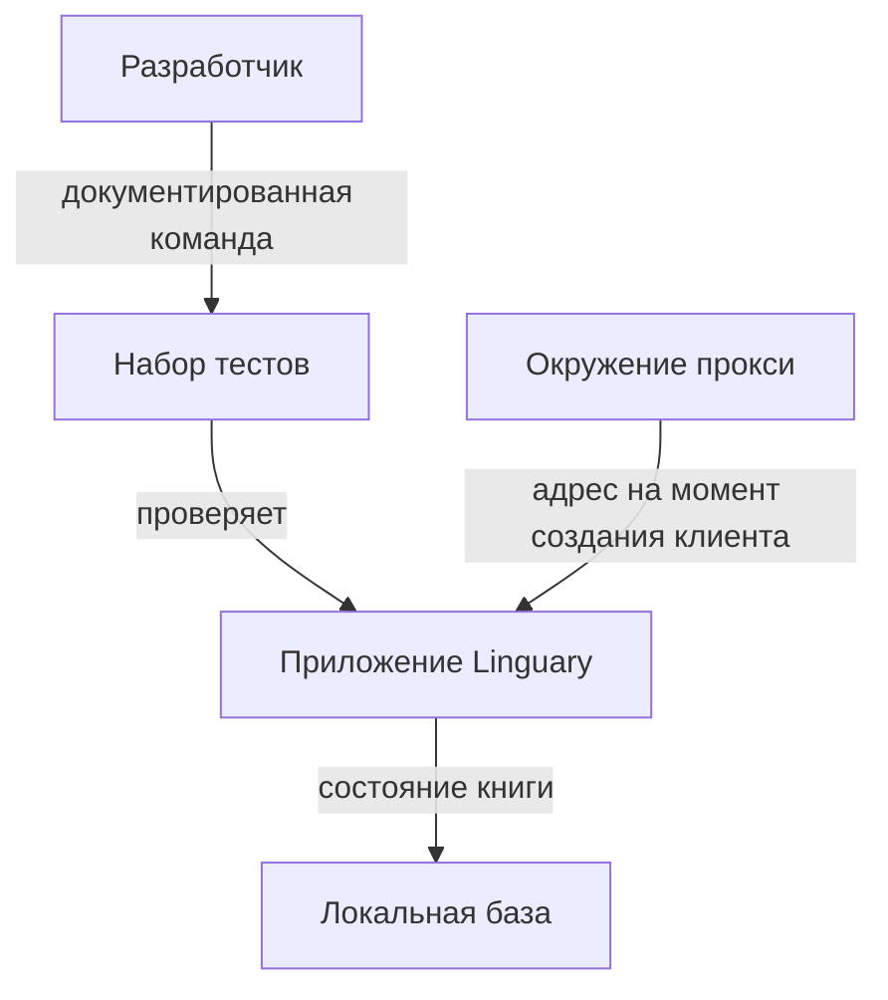
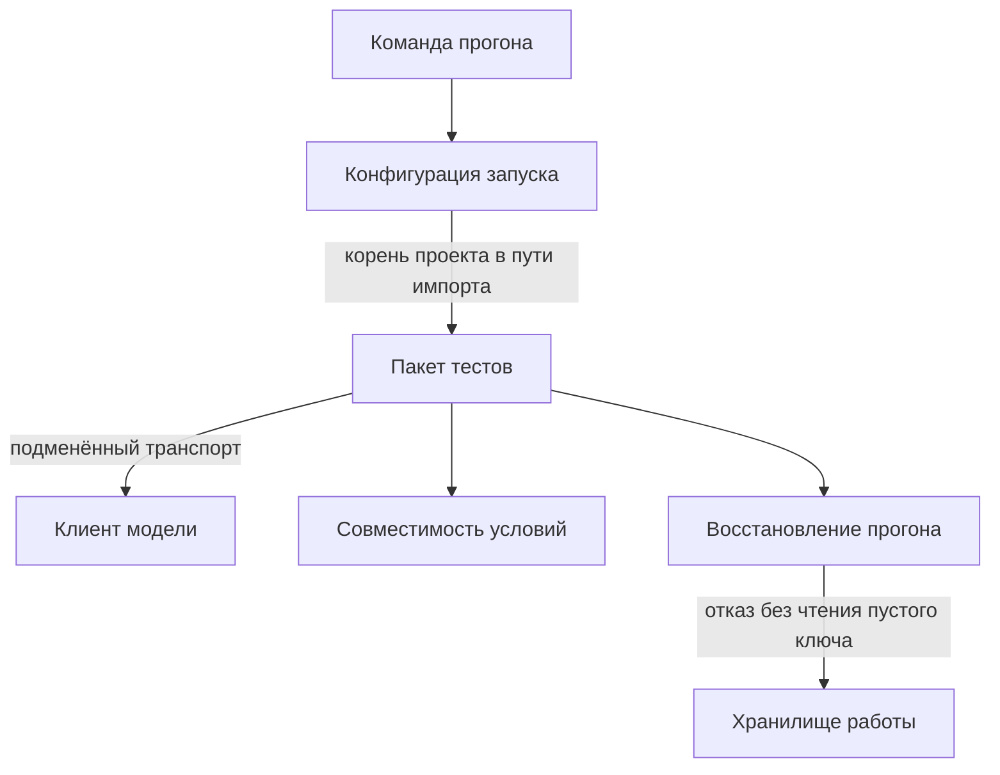

# ADR: Надёжный запуск набора тестов

> **Статус:** Accepted

- Дата: 2026-11-22
- Тема: запуск автотестов, изоляция диагностики прокси, порог покрытия
- PRD: [BRIEF-test-suite-2026-11-22.md](BRIEF-test-suite-2026-11-22.md)
- UX: нет

## 0. Коротко

- **Зачем.** Разработчик запускает тесты командой из руководства и не получает результата: набор не доходит до выполнения. Рядом с этим проверка сокрытия секрета прокси зависит от того, задан ли прокси в окружении машины, а предупреждение хранилища о пустом ключе сегодня молчит и может стать падением позже.
- **Решение.** Корень проекта становится частью пути импорта тестового запуска, и это единственное место, которое делает пакет тестов видимым. Проверка прокси сама очищает переменные прокси и задаёт свой адрес. Порог покрытия строк включается отдельной командой. Неподдерживаемый маркер условий и очистка глоссария-списка фиксируются тестами. Чтение прогона с пустым ключом заменяется прежним отказом восстановления.
- **Что меняется для пользователя.** Для читателя книги не меняется ничего. Для разработчика документированная команда начинает выполнять набор, а проверка прокси перестаёт быть красной из-за чужого окружения.
- **Чем платим.** Порог ниже измеренного покрытия, поэтому набор может тихо потерять часть строк и всё ещё быть зелёным. Одновременные переменные прокси и расхождение системного прокси с переменными окружения этой правкой не разбираются. Покрытие ветвей и поведение страничного скрипта остаются без порога.
- **На конкретном примере.** Сейчас команда из руководства останавливается на сборе, ноль тестов. Станет: та же команда выполняет набор. Проверка прокси при уже заданном прокси машины сейчас падает в автоматическом режиме. Станет: проходит без ручной очистки окружения.
- **Куда смотреть дальше.** Почему выбран путь импорта, а не смена импортов — §4 и §5. Что сознательно не трогаем в клиенте модели — §5 и §6. Что осталось допущением — §9.

## 1. Контекст

Набор тестов — пакет. Часть сквозных и интеграционных модулей импортирует общие двойники модели из этого пакета. Консольный запуск тестового инструмента не оставляет текущий каталог в пути импорта, поэтому пакет не находится, сбор прерывается, и уже собранные модули не выполняются. Запуск через модуль интерпретатора текущий каталог в путь кладёт, поэтому тот же набор выполняется.

Клиент модели в автоматическом режиме запоминает адреса прокси в момент создания. Проверка подменяет только одну переменную и оставляет остальные. На машине, где прокси уже задан несколькими именами, клиент редактирует не тот адрес, который подставила проверка.

Порога покрытия нет: доля покрытых строк может упасть незаметно. Покрытие ветвей не измеряется.

Восстановление прогона при отмене доходит до чтения прогона. Если идентификатора нет, библиотека доступа к данным предупреждает о пустом ключе. Тест при этом зелёный.

Затронуты: конфигурация тестового запуска, набор тестов, адаптер клиента модели только как объект проверки, слой совместимости условий перевода, подготовка глоссария правки главы, хранилище состояния работы.

Платформенных флагов и нескольких СУБД нет. Состояние книги живёт в одной локальной базе. Это правка инструментов и нескольких краевых веток, не новая возможность продукта.

## 2. Текущее состояние

- Руководство описывает одну команду полного прогона и вторую команду без медленных тестов.
- Медленный тест живой оценки имён пропускается, пока не задан отдельный флаг. Сетевого вызова в обычном прогоне нет.
- Пакет тестов уже используется как библиотека общих двойников. Менять эти импорты на относительные означало бы разъехать два стиля.
- Клиент модели не ходит в сеть в модульных проверках: транспорт подменён. Секреты для редактирования снимаются при создании клиента.
- Совместимость условий перевода отвергает снимок, который нельзя воспроизвести, одной ошибкой недоступности условий.
- Подготовка глоссария к запросу правки умеет и словарь, и список. Ветка списка существующими проверками не закреплена.
- Изоляция прогонов уже проверяет, что результат отменённого прогона не сохраняется.
- Архитектурные проверки направления зависимостей остаются как есть.

Сохраняем: ошибку недоступности условий, пропуск живой оценки, состав медленных тестов, смысл восстановления.

## 3. Решение

Стиль — прежняя слоистая архитектура. Меняются границы запуска тестов и два краевых отказа, а не устройство обработки книги.

**Запуск тестов.** Конфигурация запуска добавляет корень проекта в путь импорта. Документированная команда и запуск модулем интерпретатора видят пакет тестов одинаково. Импорты внутри набора не переписываются.

**Проверки.** Проверка диагностики прокси перед подменой удаляет все переменные прокси и задаёт только свой адрес. Клиент по-прежнему запоминает секреты в конструкторе из того источника, который уже выбран режимом. Продуктовое правило «какой из нескольких адресов главный» не вводится.

**Покрытие.** Порог доли строк пакета приложения — 90%. Он включается отдельной командой измерения, не каждым локальным прогоном. Ветви в порог не входят.

**Условия перевода.** Неподдерживаемый маркер контракта остаётся отказом с той же ошибкой недоступности условий. Новая проверка это закрепляет. Если отказ уже есть в коде, код совместимости не меняется.

**Правка главы.** Ветка глоссария-списка закрепляется проверкой подготовки. Служебные поля и пустая заметка не попадают в подготовленное значение. Запрос правки главы по-прежнему передаёт словарь. Новой сущности предметной области нет.

**Хранилище.** Пустой идентификатор прогона не читается. Восстановление отвечает прежней ошибкой недоступности условий. Транзакция записи результата отменённого прогона не расширяется.

**Кэш, права, установка.** Кэша и ролей нет. Локализация и схема базы не меняются. Новых таблиц и индексов нет.

**Инварианты.**

- Пакет тестов импортируется из корня проекта при любом штатном запуске.
- Текст диагностики не содержит секрет, который клиент запомнил при создании.
- Порог покрытия не замедляет обычный прогон.
- Пустой ключ не становится запросом к хранилищу.
- Ошибка недоступности условий сохраняет прежний смысл.

## 4. Рассмотренные альтернативы

### Вариант A. Починить только команду запуска

- Суть: вызывать набор модулем интерпретатора и поправить руководство.
- Плюсы: не трогает конфигурацию; текущий обход уже выполняет набор.
- Минусы: две команды снова разъедутся, как только кто-то вызовет консольный скрипт; причина останется в пути импорта.
- Минусы: проверка прокси и предупреждение хранилища не входят в этот вариант.

### Вариант B. Перевести импорты набора на относительные

- Суть: убрать импорт пакета тестов из модулей, которые падают при сборе.
- Плюсы: набор не зависит от пути импорта.
- Минусы: общие двойники придётся тащить иным способом; стиль импорта в наборе раздвоится.
- Минусы: не лечит зависимость проверки прокси от окружения.

### Вариант C. Менять снятие секретов прокси в клиенте

- Суть: научить клиент видеть любую комбинацию переменных прокси так же, как транспорт.
- Плюсы: закрыло бы расхождение системного прокси и переменных окружения, если оно есть.
- Минусы: измеренный прогон в чистом окружении уже зелёный, значит отказ относится к проверке, а не к доказанной утечке.
- Минусы: расширяет продуктовое поведение без сценария в брифе.

## 5. Обоснование

Выбран путь импорта в конфигурации запуска плюс изоляция проверки и точечные закрепления краевых веток. Так документированная команда совпадает с уже работающим запуском, а импорты набора остаются прежними.

Порог 90% ниже последнего замера: удаление неиспользуемого кода не роняет прогон. Отдельная команда измерения принята потому, что измерение замедляет каждый запуск.

Клиент модели не меняется. Проверка обязана создать те условия, которые описывает: один адрес прокси, без посторонних переменных. Разбор приоритета нескольких переменных и системного прокси отложен, потому что бриф этого сценария не требует.

## 6. Риски

- Риск 1: порог 90% пропустит потерю покрытия между полом и последним замером. Как снижаем: порог — пол, а не цель; крупные дыры по-прежнему видны в отчёте измерения.
- Риск 2: очистка переменных в проверке спрячет реальный приоритет адресов. Как снижаем: клиент не меняется, приоритет остаётся прежним и не считается покрытым этой правкой.
- Риск 3: отказ при пустом ключе заденет восстановление, где идентификатор отсутствует законно. Как снижаем: ответ — та же ошибка недоступности условий, запись результата не появляется.
- Риск 4: измерение покрытия не видит процессы, которые набор запускает отдельно. Как снижаем: порог относится к коду, исполненному внутри прогона; отдельный вход командной строки и так почти не содержит логики.

## 7. C4: Context

## 8. C4: Container & Data Flow

- Команда читает конфигурацию, конфигурация открывает пакет тестов.
- Проверка прокси очищает окружение, создаёт клиента, и только тогда клиент запоминает секреты.
- Снимок условий проверяется до продолжения обработки. Неподдерживаемый маркер даёт отказ.
- Восстановление при пустом идентификаторе отказывает, не читая сущность прогона.
- Запись результата отменённого прогона по-прежнему не выполняется.
- Сеть модели и системный прокси в этот поток не входят.

## 9. Допущения и открытые вопросы

- (допущение) Последний замер выше пола 90%, поэтому порог на текущем наборе заранее не пробит. Повторное измерение делается командой порога.
- (допущение) Неподдерживаемый маркер уже отвергается кодом. Проверка только закрепляет отказ. Если закрепление не сходится с кодом, меняется код, а не смысл ошибки.
- (допущение) Ветка глоссария-списка уже очищает служебные поля. Проверка это доказывает, а не вводит новое правило.
- (допущение) Живая оценка имён остаётся пропущенной без флага. Вынос её из набора не требуется.
- (вопрос) Нужно ли позже отдельно описать приоритет нескольких переменных прокси и системного прокси. На это решение порог и изоляция проверки не опираются.
